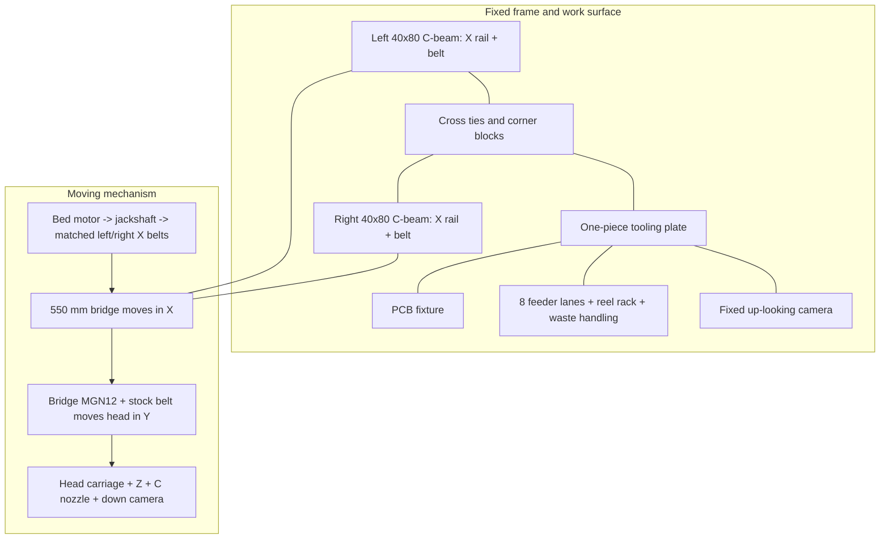
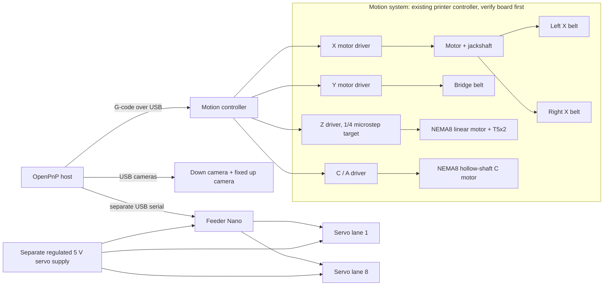
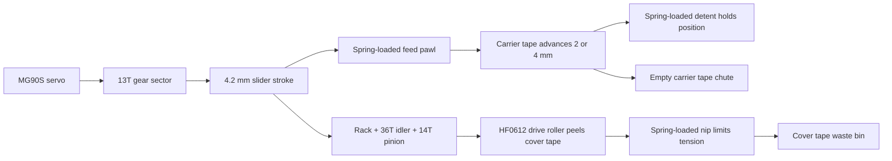
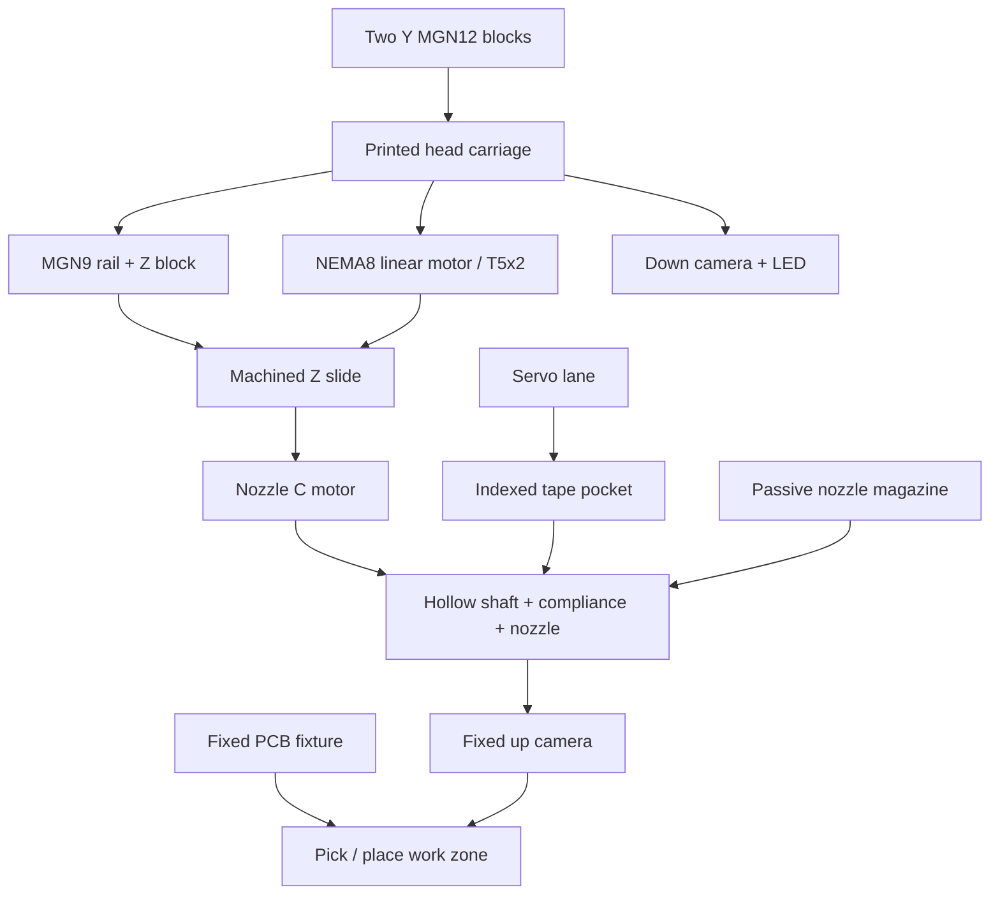

# TEVO-BW PnP: build and assembly guide

This guide connects the parametric CAD to a physical first machine. It describes the implementation represented by `params.py` and the generated `out/report.md`, including the dual-belt X drive, 8-lane motorized feeder, light Z slide and one-piece tooling plate. It is a shop build plan, not a claim that the machine has passed physical acceptance.

## 1. What is buildable now

The repository has source models and exports for the frame conversion, bridge/X-Y motion, head and tooling layout, feeder bank, printed and machined custom parts, and a generated BOM/report. The feeder has unusually complete separate assembly, electronics and first-article test documentation. `pnp/out/report.md` reports a successful modeled interference check at selected poses and current model estimates.

The build is not yet production-ready from documentation alone. The original technical specification still contains earlier choices (head-actuated feeders, stock NEMA17 Z, different carriage/table concepts); current model notes D1-D14 supersede several of them. Physical measurements, part selections and first-article test evidence are still needed. Use the model report as an estimate and the actual printer as the authority for dimensions.

## 2. CAD generation and deliverables

Use FreeCAD 1.1's bundled Python. On Windows, set the executable directory once per PowerShell session if needed:

```powershell
$env:FREECAD_BIN = "$env:LOCALAPPDATA\Programs\FreeCAD 1.1\bin"
cd D:\TEVO_BW\pnp
.\pnp.ps1 info
.\pnp.ps1 build
.\pnp.ps1 check
.\pnp.ps1 render
```

The wrapper invokes `python.exe -I pnp.py`; `FREECAD_BIN` must be the `bin` folder, not the executable. If the installed FreeCAD uses another folder name, set the variable to that location. Outputs are under `pnp/out/`: `pnp_machine.FCStd`, `pnp_machine.step`, `parts_step/`, `parts_stl/`, `bom.csv`, `report.md`, and OpenPnP coordinate JSON. `render` writes review images. `check` covers modeled geometry and selected poses only. Review the exported STEP and BOM before release to a shop; do not hand-edit generated outputs as source.

Feeder source/build is separate:

```powershell
cd D:\TEVO_BW\pnp\feeder
.\feeder.ps1 build
.\feeder.ps1 audit
```

It produces the lane and bank outputs under `pnp/feeder/out/`. For a slicer project, run `python orca_project.py` after `build`; this may need an OrcaSlicer project template as described in `feeder/README.md`.

## 3. Mechanical layout



Coordinates and clearances are in `params.py`; the machine is modeled from the frame origin, while generated OpenPnP coordinates use the nozzle-at-home origin. Do not mix those coordinate frames when locating parts or entering camera offsets.

### Axis and control paths



The existing printer controller and the feeder Nano are separate devices. The machine controller handles motion and the feeder controller advances tape; do not connect servo power to the Nano's USB 5 V rail. The installed board, driver outputs, voltage and pin mapping must be documented during the initial survey before wiring.

### Feeder force and tape path



This is a functional path, not an exploded drawing. The lane's printable part orientation, hardware, assembly order, bearing direction and adjustment procedure are specified in [feeder/ASSEMBLY.md](feeder/ASSEMBLY.md).

## 4. Physical assembly sequence

Follow the specification's WP0-WP10 as a useful staged checklist, but apply the revision mapping below before following individual steps. The sequence below reflects the current modeled architecture.

1. **Survey and baseline.** Photograph and label the installed board, drivers, PSU voltage, connectors, motors and endstops. Measure the actual C-beam gap, extrusion lengths, tie positions, plate flatness and usable travel. Record replacements for the WP0 assumptions in `params.py`; preserve all settings and wiring before disassembly.
2. **Rebuild the base.** Isolate mains and PSU power. Remove the bed/heater and Z screw drive. Lay the two C-beams parallel as X rails, install ties and four corner/drive blocks, level the frame, then mount the tooling plate and standoffs. Verify diagonal equality and plate flatness before attaching motion hardware.
3. **Install X motion.** Align the two MGN12 rails in a common plane, fit bridge blocks/ends and the 550 mm bridge. Mount both GT2 belts, jackshaft, motor and tensioners. Phase the belts together and measure bridge yaw at both ends of travel before tightening.
4. **Install Y motion.** Fit the MGN12 rail and belt to the bridge, carriage and motor/idler hardware. Route the chain and confirm the full carriage path clears the frame, plate, feeders and camera.
5. **Build the head on the bench.** Assemble the printed carriage, MGN9 Z guide, NEMA8 linear motor/T5x2 slide, C rotation motor, nozzle shaft/compliance, camera and endstop. Check free Z travel and nozzle runout before mounting. Keep the moving head below the modeled 500 g target; weigh the real assembly.
6. **Mount tooling and optics.** Install the PCB fixture/clamp, up camera, nozzle magazine, feeder bank and tape/waste routing. Align all mounting faces to the plate datum. Validate camera/nozzle offsets and each target's reach from actual home positions.
7. **Wire and configure motion.** Verify the actual controller pinout and voltage before connecting. Configure X/Y/Z/C steps, directions, limits, microstepping and safe homing for the installed board. Current modeled Z uses 1/4 microstepping and 400 steps/mm; do not copy legacy 1/16 settings. Ensure heater outputs are disabled and repurposed safely before connecting valves or other loads.
8. **Feeder first article.** Build one v3.0 lane exactly per `pnp/feeder/ASSEMBLY.md`, wire it per `ELECTRONICS.md`, and run `TEST.md`. Confirm 2/4 mm feed, cover-tape take-up, clutch direction, reliable pocket registration and servo temperature before replicating seven lanes.
9. **Build the power/control panel.** Use `pnp/electronics/POWER_CONTROL_DESIGN.md`, the wiring diagram and enclosure render. First identify the donor board/drivers and every load; do not wire from assumed 12/24 V. Keep the motion board, vacuum, feeder servo rail and SBC on separate protected branches. Test E-stop hardware before enabling motion.
10. **Commission slowly.** Start with motor power limited and conservative acceleration. Home each axis independently, check travel limits, belt retention, cable chains and emergency stop. Validate vacuum, blow-off, camera calibration, nozzle changes, feeder positions and OpenPnP safe Z before any automatic cycle.
11. **Acceptance and release.** Record physical measurements and results against specification section 11 / WP10. Do not call cycle-rate, placement accuracy or unattended operation validated until those tests have been run on hardware.

## 5. Head and feeder subassembly schemes



The feeder's detailed part order, fastener sizes, wiring, firmware and calibration already live in `pnp/feeder/ASSEMBLY.md`, `ELECTRONICS.md`, `OPENPNP.md` and `TEST.md`. Use those as the controlling lane-level procedures; this overview does not replace them.

## 6. Power/control panel

The preliminary electrical design, block-level schematic, enclosure concept render, bill of materials and bring-up gates are in [`electronics/POWER_CONTROL_DESIGN.md`](electronics/POWER_CONTROL_DESIGN.md). The proposed SBC is a Raspberry Pi 5 with a separate official supply; verify OpenPnP and both cameras on ARM64 before committing to it. The feeder Nano stays a separate USB serial device, with servo current supplied by the dedicated 5 V branch. The enclosure itself is not yet part of the FreeCAD machine assembly; fit, ventilation, electrical protection and actual donor hardware remain open checks.

## 7. Revision map and known design changes

| Topic | Earlier technical specification | Current modeled direction |
| --- | --- | --- |
| Tape advance | Nozzle presses passive lever lanes | Eight independent servo-driven TBW-Feeder v3.0 lanes, separate Nano/controller |
| Z | Former NEMA17 and TR8x2 | NEMA8 linear motor and T5x2; lightweight carriage |
| X bridge | Dual belts/jackshaft architecture was proposed | Implemented in current model with two MGN12 X rails and dual GT2 belts |
| Tooling plate | Reuse bed only if flat, otherwise replace | One-piece 6 mm plate carries PCB and feeder/tooling strip |
| Head | Modular plate concept | Integrated printed head carriage plus machined Z slide |
| Z microsteps | Legacy assumptions vary | Current parameters/report use 1/4 microstep, 400 steps/mm |

Before fabrication, reconcile the specification's sections 2, 3, 7, 8, 11 and WP1-WP10 against `params.py`, current model, report and measured machine. The model report's own design notes D1-D14 are the current decision record but are not a substitute for a revised, controlled specification.

## 7. Changes that would make the project easier to build

Prioritize these updates before a complete machine build:

1. **Publish a rev 2 specification.** Move D1-D14 into a dated change log, replace obsolete head-actuated feeder instructions and update BOM/electrical assumptions. Identify the controller/motor/PSU variant explicitly.
2. **Add fit-critical drawings.** For every machined item, publish dimensioned PDF/DXF drawings with datum scheme, tolerances, stock size, finish and inspection dimensions. STEP alone is not a machining drawing. Add rail alignment and tooling-plate drilling templates.
3. **Make the BOM procurement-ready.** Add manufacturer/part number, quantity, source, voltage/rating, substitutions and “verify before purchase” status. Separate reused printer parts, bought parts, printed parts and machined parts; resolve any generated BOM omissions before ordering.
4. **Create a wiring pack.** Provide one board-specific pin map, connector view, power distribution diagram, fuse/wire sizing and valve/servo isolation details. Current documentation spans two control systems: the original motion board and the feeder Nano.
5. **Add a whole-machine commissioning checklist.** Record homing direction, endstop logic, travel limits, steps/mm, belt tension, squareness, Z safe height, vacuum response and camera calibration with pass/fail evidence.
6. **Capture physical validation.** Weigh the head, measure runout/flatness/reach, test belt yaw and repeated placement, and update model assumptions from those measurements. Distinguish modeled checks from hardware-verified checks in reports.
7. **Improve release packaging.** Add a versioned release folder or archive containing source revision, FreeCAD version, generated STEP/STL/BOM/report, slicer profile and firmware revision. Keep generated outputs traceable to the source revision.

### Current manufacturing split

Use the generated BOM as the detailed quantity list. The model report currently identifies 150 printed part instances and 9 machined custom items, plus 411 fasteners. These are CAD-derived counts and need a purchase review against the actual donor printer before ordering.

| Work type | Examples | Release input |
| --- | --- | --- |
| Reuse and measure | C-beams, bridge extrusion, motors, controller, PSU, belts and selected hardware | WP0 survey sheet and actual dimensions |
| Print | Corner blocks, bridge ends, head carriage, feeder lanes, reel rack and camera housing | `parts_stl/`, slicer profile, material and orientation table in `out/report.md` |
| Machine | Tooling plate, Z slide, Y motor/idler brackets, nozzle magazine, camera angle and tension blocks | `parts_step/` plus dimensioned drawings to be added |
| Buy | Linear rails/blocks, bearings, motors, screws, springs, optics, vacuum parts and feeder electronics | `bom.csv` with vendor and electrical ratings verified |
| Wire/configure | Motion board, feeder Nano, cameras, vacuum valves, endstops and emergency stop | Board-specific wiring pack to be added |

### Build gates

| Gate | Evidence required before continuing |
| --- | --- |
| Frame accepted | Measured rail gap, diagonals, level, plate support and PCB-area flatness recorded |
| Motion accepted | X/Y homes and limits correct; bridge yaw measured; no belt derailment or missed steps at the chosen profile |
| Head accepted | Z stroke and homing correct; head mass weighed; C runout and nozzle repeatability measured |
| Feeder accepted | One lane passes `pnp/feeder/TEST.md`, including feed, peel, tape registration and endurance checks selected for first article |
| Integration accepted | OpenPnP coordinates generated from the as-built model; camera offsets taught; Safe Z physically verified |
| Machine accepted | Specification WP10/section 11 test records complete with pass/fail and measured data |

## 8. Practical limits

- The reported no-interference result applies to the modeled parts and sampled poses, not cable snagging, assembly tolerance stack-up or deflection under acceleration.
- PETG/PETG-CF printed load-bearing parts may creep; verify fastener retention, temperature and belt loads on hardware. The large corner blocks and bridge ends deserve inspection after initial motion tests.
- The feeder audit reports geometry/mechanism checks, while the feeder README still calls for a physical first article. Run that article before printing the full bank.
- Cycle time, torque margins, reach, mass and printability are model estimates dependent on actual motors, power supply, rail alignment, slicer and firmware settings.
- The stock CAD archive includes several printer revisions. Confirm every reused part against the actual machine before ordering or machining around it.
